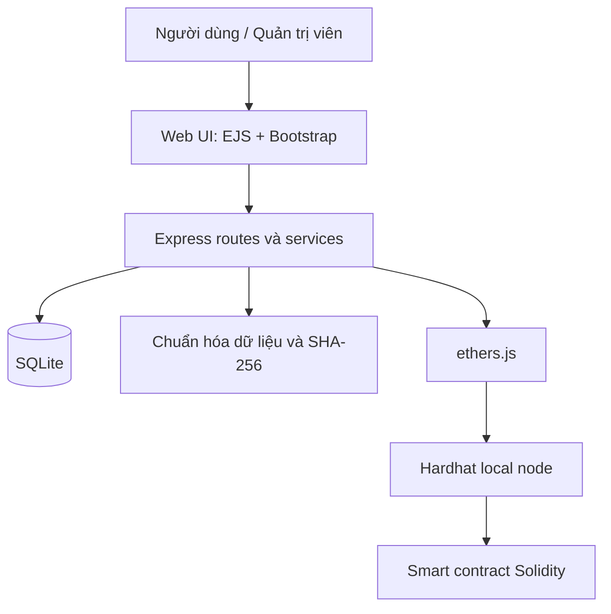
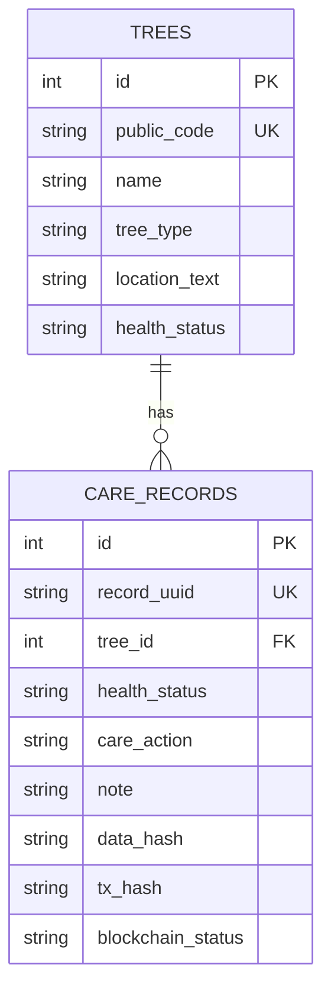

# ROADMAP 21 NGÀY — URBANTREE LEDGER
## Ứng dụng quản lý cây xanh và xác minh lịch sử chăm sóc bằng Blockchain

> **Phiên bản:** 1.0 — MVP học phần  
> **Thời gian:** 21 ngày  
> **Nhân lực giả định:** 1 sinh viên  
> **Mục tiêu:** Có ứng dụng web chạy được, demo được một luồng Blockchain thật trên mạng local và đủ tài liệu để viết báo cáo học phần.  
> **Nguyên tắc:** Làm ít chức năng nhưng hoàn chỉnh; không cố hoàn thành bản đồ, app mobile, AI hay hệ thống quản lý đô thị quy mô lớn.

---

# 1. Chốt đề tài và phạm vi

## 1.1. Tên đề tài nên dùng

**“Xây dựng ứng dụng quản lý lịch sử chăm sóc cây xanh ứng dụng Blockchain để xác minh tính toàn vẹn dữ liệu.”**

Tên ngắn khi trình bày: **UrbanTree Ledger**.

Tên này gọn hơn đề tài quản lý cây xanh đô thị tích hợp đầy đủ QR, bản đồ, phản ánh, app nhân viên và dashboard. Trọng tâm học phần là chứng minh Blockchain được dùng vào một bài toán cụ thể, không phải số lượng màn hình.

## 1.2. Bài toán

Thông tin cây và lịch sử chăm sóc có thể được lưu trong cơ sở dữ liệu thông thường. Tuy nhiên, nếu một bản ghi lịch sử bị sửa sau khi ghi nhận, người xem khó biết nội dung đã thay đổi hay chưa.

Ứng dụng cho phép quản lý hồ sơ cây, ghi nhận lần chăm sóc và tạo mã QR để mở trang chi tiết. Khi lưu bản ghi chăm sóc, hệ thống tạo hash của dữ liệu đã chuẩn hóa rồi ghi hash lên smart contract chạy trên Blockchain local. Khi xác minh, ứng dụng tính lại hash từ dữ liệu hiện tại và so sánh với hash trên Blockchain. Nếu dữ liệu bị sửa, kết quả xác minh phải báo không khớp.

## 1.3. Mục tiêu MVP có thể hoàn thành

1. Quản trị viên đăng nhập bằng tài khoản demo.
2. Thêm, sửa và xem danh sách cây xanh.
3. Mỗi cây có mã định danh như `TREE-001`.
4. Xem trang chi tiết cây và lịch sử chăm sóc.
5. Thêm bản ghi chăm sóc gồm tình trạng, hoạt động, ghi chú và ngày thực hiện.
6. Tạo QR cho trang chi tiết cây.
7. Ghi hash của bản ghi chăm sóc lên smart contract trên Hardhat local.
8. Hiển thị trạng thái ghi Blockchain, transaction hash và kết quả xác minh.
9. Có chức năng demo sửa dữ liệu trong môi trường thử nghiệm để cho thấy xác minh phát hiện dữ liệu đã thay đổi.
10. Có dữ liệu mẫu, hướng dẫn cài đặt, kiểm thử và báo cáo học phần.

## 1.4. Những gì chủ động bỏ khỏi phiên bản 21 ngày

Không làm trong MVP:

- Ứng dụng Flutter riêng cho nhân viên.
- Hai ứng dụng React riêng cho Admin và người dân.
- Bản đồ tương tác Leaflet/OpenStreetMap.
- Gửi phản ánh sự cố công khai, upload ảnh và theo dõi xử lý nhiều trạng thái.
- Phân công nhân viên, thông báo, dashboard phân tích nâng cao.
- AI nhận diện bệnh cây hoặc dự đoán cây đổ.
- IoT, cảm biến, GPS bắt buộc.
- Blockchain public mainnet, token, ví người dùng hoặc thanh toán.
- Deploy production lên Internet.

**QR chỉ là lối tắt để mở trang thông tin cây; QR không tự tạo ra tính bảo mật.** Tính toàn vẹn được minh họa bằng hash và smart contract.

## 1.5. Tiêu chí nghiệm thu

| ID | Tiêu chí | Bằng chứng khi demo |
|---|---|---|
| AC-01 | Tạo và xem hồ sơ cây | Trang danh sách và chi tiết cây |
| AC-02 | Thêm lịch sử chăm sóc | Bản ghi xuất hiện trong lịch sử |
| AC-03 | Tạo QR cho cây | Quét QR mở đúng trang cây |
| AC-04 | Ghi hash lên Blockchain | Có transaction hash và trạng thái thành công |
| AC-05 | Xác minh dữ liệu chưa đổi | Hiển thị “Hợp lệ / Hash khớp” |
| AC-06 | Phát hiện dữ liệu bị sửa | Sau khi sửa dữ liệu thử nghiệm, hiển thị “Không khớp” |
| AC-07 | Có báo cáo và hướng dẫn chạy | Có file báo cáo, README, ảnh minh họa |

---

# 2. Công nghệ: chọn một đường đi duy nhất

## 2.1. Stack đề xuất cho thời hạn ngắn

| Thành phần | Công nghệ | Lý do |
|---|---|---|
| Giao diện + server | Node.js + Express + EJS | Dùng một ứng dụng web, không phải dựng React và API riêng |
| CSS | Bootstrap 5 | Có sẵn form, bảng, navbar, card, responsive |
| Database | SQLite | Không phải cài và cấu hình MySQL; phù hợp dữ liệu demo |
| Blockchain | Solidity + Hardhat local | Có smart contract thật, chạy trên máy cá nhân |
| Kết nối contract | ethers.js | JavaScript kết nối EVM thuận tiện |
| Hash dữ liệu | SHA-256 | Tạo dấu vân tay dữ liệu để so sánh |
| QR | Thư viện tạo QR phía server | Sinh QR trỏ đến URL chi tiết cây |
| Kiểm thử API/luồng | Trình duyệt + Postman nếu cần | Kiểm tra các luồng chính |
| Sơ đồ | diagrams.net hoặc Mermaid | ERD, kiến trúc, sequence diagram |
| Quản lý mã nguồn | Git + GitHub | Lưu lịch sử và backup mã nguồn |

**Không đổi stack giữa chừng.** Nếu môn học hoặc giảng viên bắt buộc Java/Spring Boot, hãy giữ Spring Boot nhưng cần kiểm tra khả năng tích hợp EVM ngay ngày 1. Với thời hạn 21 ngày và một sinh viên, Node.js + Express + ethers.js là đường đi ngắn hơn.

## 2.2. Môi trường local

Ứng dụng demo chạy trên một máy tính:

- Web server Express.
- SQLite lưu hồ sơ cây và lịch sử chăm sóc.
- Hardhat node chạy Blockchain local.
- Smart contract được deploy lên node local.
- Trình duyệt mở giao diện web.

Blockchain local **không phải mạng Blockchain công khai**. Khi node bị reset, dữ liệu chain và địa chỉ contract có thể thay đổi; cần chạy lại script deploy trước buổi demo.

## 2.3. Kiến trúc tối giản



## 2.4. Nguyên tắc lưu dữ liệu

- SQLite lưu thông tin đầy đủ của cây và bản ghi chăm sóc.
- Blockchain chỉ lưu `recordId`, loại bản ghi, hash dữ liệu và thời điểm ghi theo thiết kế contract.
- Không lưu ảnh, tên/số điện thoại cá nhân hoặc toàn bộ hồ sơ cây lên Blockchain.
- Hash chỉ chứng minh dữ liệu có khớp với dấu hash đã ghi hay không; không chứng minh người nhập dữ liệu ban đầu nói thật.
- Khi Blockchain lỗi, giao diện phải báo rõ chưa ghi được bằng chứng; không hiển thị thành công giả.

---

# 3. Chức năng và giao diện cần làm

## 3.1. Sơ đồ điều hướng

```text
UrbanTree Ledger
├── Đăng nhập
├── Dashboard
├── Quản lý cây
│   ├── Danh sách cây
│   ├── Thêm cây
│   └── Chi tiết cây
│       ├── Thông tin cơ bản
│       ├── QR Code
│       ├── Lịch sử chăm sóc
│       └── Xác minh Blockchain
├── Thêm bản ghi chăm sóc
├── Danh sách bằng chứng Blockchain
└── Giới thiệu / Hướng dẫn demo
```

Để kịp tiến độ, có thể dùng một tài khoản quản trị demo và session đăng nhập đơn giản. Nếu chưa đủ thời gian cho bảo mật đầy đủ, ghi rõ đây là nguyên mẫu học phần; không tuyên bố hệ thống sẵn sàng cho production.

## 3.2. Màn hình 1 — Đăng nhập

Thành phần:
- Logo biểu tượng chiếc lá.
- Tên “UrbanTree Ledger”.
- Email/tên đăng nhập và mật khẩu.
- Nút “Đăng nhập”.
- Tài khoản demo ghi trong README, không dùng mật khẩu cá nhân.

Không cần đăng ký tài khoản, quên mật khẩu hoặc xác thực email.

## 3.3. Màn hình 2 — Dashboard

Bố cục:
- Thanh điều hướng xanh lá.
- 3 thẻ số liệu: tổng số cây, tổng bản ghi chăm sóc, số bằng chứng Blockchain đã ghi.
- Bảng “Hoạt động chăm sóc gần đây”.
- Nút “Thêm cây” và “Ghi nhận chăm sóc”.

Số liệu phải lấy từ SQLite thật; không để số tĩnh nếu đã có dữ liệu.

## 3.4. Màn hình 3 — Danh sách cây

Các cột:
- Mã cây.
- Tên cây.
- Loại cây.
- Vị trí/địa chỉ mô tả.
- Tình trạng.
- Nút “Chi tiết”.

Chức năng:
- Tìm theo mã hoặc tên.
- Lọc đơn giản theo tình trạng nếu kịp.
- Thêm cây.
- Mỗi cây có `publicCode` duy nhất.

Dữ liệu mẫu nên có 8–12 cây để trình diễn.

## 3.5. Màn hình 4 — Thêm/sửa cây

Trường dữ liệu:
- Mã cây: sinh tự động hoặc nhập theo quy tắc.
- Tên hiển thị.
- Loại cây.
- Vị trí mô tả.
- Ngày trồng (không bắt buộc).
- Tình trạng hiện tại: Tốt / Cần theo dõi / Kém / Nguy hiểm / Chưa rõ.
- Ghi chú công khai.

Kiểm tra dữ liệu bắt buộc và mã cây không trùng. Không cần bản đồ hoặc tọa độ trong MVP.

## 3.6. Màn hình 5 — Chi tiết cây và QR

Hiển thị:
- Mã cây, tên, loại, vị trí và tình trạng.
- QR dẫn đến URL chi tiết.
- Nút tải/in QR nếu thư viện hỗ trợ.
- Bảng lịch sử chăm sóc.
- Nút “Thêm bản ghi chăm sóc”.
- Trạng thái xác minh của từng bản ghi.

Nếu demo bằng một máy, QR có thể trỏ tới `http://localhost:3000/trees/TREE-001`. Nếu quét từ điện thoại khác, phải dùng địa chỉ IP LAN của máy chạy server thay cho `localhost`.

## 3.7. Màn hình 6 — Thêm bản ghi chăm sóc

Trường dữ liệu:
- Cây được chọn.
- Tình trạng sau khi kiểm tra.
- Hoạt động: tưới nước / cắt tỉa / bón phân / kiểm tra / xử lý khác.
- Ghi chú.
- Ngày giờ thực hiện.

Sau khi nhấn lưu:
1. Validate dữ liệu.
2. Tạo bản ghi trong SQLite.
3. Chuẩn hóa các trường đã chọn thành chuỗi ổn định.
4. Tạo SHA-256 hash.
5. Gọi smart contract để ghi dấu.
6. Lưu transaction hash và trạng thái Blockchain vào SQLite.
7. Hiển thị rõ thành công hay lỗi.

Nếu ghi Blockchain lỗi, bản ghi chăm sóc có thể vẫn tồn tại trong SQLite với trạng thái `FAILED` hoặc `PENDING`, và phải có nút thử lại hoặc hướng dẫn xử lý.

## 3.8. Màn hình 7 — Xác minh Blockchain

Hiển thị:
- Mã bản ghi.
- Hash tính từ dữ liệu hiện tại.
- Hash đã ghi trên contract.
- Transaction hash.
- Kết quả: `VALID` nếu trùng, `MISMATCH` nếu không trùng, hoặc `UNAVAILABLE` nếu không truy cập được Blockchain.

Nút “Xác minh lại”.

Để demo phát hiện sửa dữ liệu, chỉ sử dụng bản ghi thử nghiệm. Có thể tạo một lệnh/script quản trị dành riêng cho môi trường demo để thay đổi ghi chú trong SQLite, sau đó xác minh lại. Không đưa nút sửa dữ liệu tùy ý vào giao diện người dùng thông thường.

## 3.9. Thiết kế giao diện

Bảng màu gợi ý:
- Xanh lá đậm: `#216E52`.
- Xanh lá trung bình: `#4C956C`.
- Nền: `#F6F8F6`.
- Card: `#FFFFFF`.
- Chữ: `#1F2937`.
- Cảnh báo: `#D97706`.
- Lỗi/không khớp: `#DC2626`.

Phong cách:
- Sidebar hoặc navbar gọn.
- Nền sáng, card trắng, bo góc vừa phải.
- Bảng rõ ràng, form ngắn.
- Trạng thái phải có chữ, không chỉ dựa vào màu.
- Responsive ở mức cơ bản; ưu tiên giao diện desktop cho buổi demo.

---

# 4. Mô hình dữ liệu tối thiểu

## 4.1. Bảng `trees`

| Cột | Kiểu | Ý nghĩa |
|---|---|---|
| id | INTEGER PK | ID nội bộ |
| public_code | TEXT UNIQUE | Mã cây, ví dụ TREE-001 |
| name | TEXT | Tên hiển thị |
| tree_type | TEXT | Loại cây |
| location_text | TEXT | Mô tả vị trí |
| health_status | TEXT | Tình trạng hiện tại |
| planted_date | TEXT NULL | Ngày trồng nếu biết |
| note | TEXT NULL | Ghi chú |
| created_at | TEXT | Ngày tạo |

## 4.2. Bảng `care_records`

| Cột | Kiểu | Ý nghĩa |
|---|---|---|
| id | INTEGER PK | ID nội bộ |
| record_uuid | TEXT UNIQUE | ID ổn định để ghi Blockchain |
| tree_id | INTEGER FK | Cây liên quan |
| health_status | TEXT | Tình trạng được ghi nhận |
| care_action | TEXT | Hoạt động chăm sóc |
| note | TEXT | Ghi chú |
| performed_at | TEXT | Ngày giờ thực hiện |
| created_at | TEXT | Ngày lưu hệ thống |
| data_hash | TEXT NULL | SHA-256 của dữ liệu chuẩn hóa |
| tx_hash | TEXT NULL | Transaction hash |
| blockchain_status | TEXT | PENDING / CONFIRMED / FAILED |

## 4.3. Bảng `blockchain_audits` (có thể gộp vào `care_records`)

Nếu muốn giảm độ phức tạp, lưu `data_hash`, `tx_hash`, `block_number` và `blockchain_status` ngay trong `care_records`. Chỉ tạo bảng riêng khi thực sự cần lưu nhiều lần thử ghi Blockchain.

## 4.4. ERD MVP



---

# 5. Thiết kế smart contract

## 5.1. Mục đích contract

Contract chỉ lưu bằng chứng hash, không thay thế database. Dữ liệu gốc nằm trong SQLite; contract giữ hash để có thể so sánh sau này.

## 5.2. Dữ liệu nên ghi

Một record bằng chứng gồm:
- `recordId`: UUID của bản ghi chăm sóc.
- `recordType`: ví dụ `CARE`.
- `dataHash`: hash 32 byte.
- `timestamp`: thời gian do Blockchain local ghi nhận.
- Event `RecordAnchored` để truy vết transaction.

Contract cần:
- Cho phép ghi bằng chứng mới.
- Từ chối `recordId` trùng nếu thiết kế một bằng chứng cho mỗi bản ghi.
- Cho phép đọc bằng chứng theo `recordId`.
- Có test ghi, đọc và chống trùng.

## 5.3. Quy tắc tạo hash

Chỉ hash các trường đã thống nhất, theo thứ tự cố định. Ví dụ dữ liệu logic:

```json
{
  "recordUuid": "UUID-EXAMPLE",
  "treeCode": "TREE-001",
  "healthStatus": "GOOD",
  "careAction": "WATERING",
  "note": "Đã tưới nước",
  "performedAt": "2026-10-23T08:00:00"
}
```

Đây chỉ là ví dụ minh họa. Khi lập trình, phải dùng cùng một hàm chuẩn hóa khi ghi và khi xác minh; không tự ghép chuỗi theo thứ tự không nhất quán.

Luồng:
1. Chọn các trường bằng chứng.
2. Chuẩn hóa thành chuỗi ổn định.
3. Tính SHA-256.
4. Chuyển hash sang dạng `bytes32` để gọi contract.
5. Lưu `txHash` và trạng thái sau khi transaction được xác nhận.
6. Khi verify, đọc hash từ contract, tính lại hash và so sánh.

**Lưu ý học thuật:** hash là dấu vân tay dữ liệu, không phải mã hóa. Blockchain không tự xác minh sự thật của dữ liệu đầu vào.

---

# 6. Roadmap 21 ngày

## Giai đoạn 1 — Khóa phạm vi và dựng nền tảng (Ngày 1–3)

### Ngày 1: Chốt đề tài và kịch bản demo
- Chép tên đề tài vào tài liệu.
- Chốt danh sách chức năng MVP ở mục 1.
- Viết 3 câu hỏi mà sản phẩm phải trả lời: quản lý cây ra sao, lịch sử chăm sóc lưu thế nào, làm sao phát hiện dữ liệu bị sửa.
- Chốt kịch bản demo: tạo cây → thêm chăm sóc → ghi Blockchain → verify → thử sửa dữ liệu → verify không khớp.
- Tạo thư mục `docs/`, `src/`, `blockchain/`, `public/`, `views/`.

**Bàn giao:** `docs/scope.md`, repo Git khởi tạo.

### Ngày 2: Cài công cụ và kiểm tra môi trường
- Cài/kiểm tra Node.js phiên bản LTS.
- Khởi tạo Express app.
- Cài EJS và Bootstrap.
- Khởi tạo SQLite và thử tạo một bảng.
- Khởi tạo project Hardhat trong thư mục `blockchain/`.
- Chạy thử node local và deploy contract mẫu theo tài liệu công cụ.
- Ghi lại phiên bản các công cụ trong README.

**Bàn giao:** web chạy được, SQLite kết nối được, Hardhat node khởi động được.

### Ngày 3: Thiết kế dữ liệu và giao diện nháp
- Vẽ ERD hai bảng `trees`, `care_records`.
- Vẽ sơ đồ kiến trúc.
- Vẽ wireframe Dashboard, danh sách cây, chi tiết cây, form chăm sóc, trang verify.
- Tạo seed data cho 8–12 cây.
- Viết README với hướng dẫn khởi động ban đầu.

**Bàn giao:** ERD, wireframe, dữ liệu mẫu, README sơ bộ.

**Cổng nghiệm thu ngày 3:** Không thêm chức năng ngoài phạm vi. Nếu chưa chạy được Hardhat local, ưu tiên giải quyết ngay trước khi xây giao diện.

## Giai đoạn 2 — Web và database (Ngày 4–8)

### Ngày 4: Layout và điều hướng
- Tạo navbar/sidebar.
- Tạo layout EJS dùng chung.
- Thêm Bootstrap và stylesheet riêng.
- Tạo các route trang chính.
- Tạo trang đăng nhập demo.

**Bàn giao:** tất cả trang mở được, dù chưa có dữ liệu thật.

### Ngày 5: SQLite và CRUD cây
- Tạo bảng `trees`.
- Viết hàm truy vấn danh sách cây.
- Làm form thêm cây.
- Validate mã cây và các trường bắt buộc.
- Hiển thị lỗi dễ hiểu khi mã bị trùng.

**Bàn giao:** thêm cây và xem danh sách được.

### Ngày 6: Chi tiết và chỉnh sửa cây
- Làm trang chi tiết.
- Làm form chỉnh sửa.
- Thêm tìm kiếm theo mã/tên.
- Thêm trạng thái sức khỏe.
- Kiểm tra dữ liệu vẫn còn sau khi restart web server.

**Bàn giao:** luồng quản lý cây hoạt động với SQLite.

### Ngày 7: Lịch sử chăm sóc
- Tạo bảng `care_records`.
- Làm form chăm sóc.
- Liên kết bản ghi với cây bằng `tree_id`.
- Hiển thị lịch sử trong trang chi tiết.
- Không cho xóa hoặc ghi đè lịch sử cũ trong luồng bình thường.

**Bàn giao:** cây có thể có nhiều bản ghi chăm sóc.

### Ngày 8: Dashboard và QR
- Làm thẻ tổng số cây và tổng số bản ghi.
- Làm bảng hoạt động gần đây.
- Sinh QR trỏ tới trang chi tiết cây.
- Quét thử QR bằng camera điện thoại.
- Nếu chỉ demo trên máy tính, QR dùng URL local; nếu quét từ điện thoại khác, cấu hình IP LAN.

**Bàn giao:** giao diện nghiệp vụ cơ bản hoàn chỉnh.

**Cổng nghiệm thu ngày 8:** có thể tạo cây, xem cây, thêm lịch sử và quét QR. Chưa cần Blockchain hoạt động trên mọi màn hình.

## Giai đoạn 3 — Smart contract và kết nối Blockchain (Ngày 9–14)

### Ngày 9: Viết contract tối thiểu
- Tạo struct hoặc mapping lưu bằng chứng.
- Viết hàm ghi bằng chứng.
- Viết hàm đọc bằng chứng.
- Thêm event.
- Ngăn ghi trùng `recordId`.
- Viết test cho ghi mới, đọc và ghi trùng.

**Bàn giao:** contract compile và test pass.

### Ngày 10: Deploy local và kết nối JavaScript
- Viết script deploy contract.
- Chạy Hardhat node.
- Deploy contract.
- Lưu contract address và ABI ở vị trí cấu hình phù hợp.
- Viết script Node.js nhỏ để ghi và đọc một hash thử.
- Xác nhận transaction thành công trước khi tích hợp UI.

**Bàn giao:** script ngoài giao diện gọi contract được.

### Ngày 11: Chuẩn hóa dữ liệu và SHA-256
- Chọn chính xác các trường sẽ được bảo vệ.
- Viết hàm `canonicalizeCareRecord`.
- Viết hàm SHA-256.
- Tạo test để cùng dữ liệu luôn cho cùng hash.
- Kiểm tra thay đổi một trường sẽ tạo hash khác.

**Bàn giao:** hàm hash có test.

### Ngày 12: Ghi bằng chứng khi thêm chăm sóc
- Khi lưu bản ghi, ghi dữ liệu nghiệp vụ vào SQLite.
- Tính hash từ bản ghi đã lưu.
- Gọi contract ghi `recordUuid` và hash.
- Chờ transaction receipt.
- Lưu `data_hash`, `tx_hash`, `blockchain_status`.
- Xử lý lỗi: dữ liệu SQLite vẫn được giữ, trạng thái Blockchain ghi rõ thất bại/chờ xử lý.

**Bàn giao:** tạo bản ghi chăm sóc có thể ghi hash lên Blockchain local.

### Ngày 13: Trang bằng chứng Blockchain
- Hiển thị hash hiện tại.
- Hiển thị transaction hash.
- Hiển thị trạng thái `CONFIRMED`, `PENDING` hoặc `FAILED`.
- Làm trang danh sách các bản ghi có bằng chứng.
- Nếu còn thời gian, tạo liên kết tới block/transaction trong công cụ local; không dùng explorer public cho chain local.

**Bàn giao:** người xem hiểu được bằng chứng nào đã được ghi.

### Ngày 14: Xác minh đầu-cuối
- Đọc bản ghi chăm sóc từ SQLite.
- Tính lại hash bằng cùng hàm chuẩn hóa.
- Đọc hash đã lưu từ contract.
- So sánh hai giá trị.
- Hiển thị `VALID`, `MISMATCH` hoặc `UNAVAILABLE`.
- Test khi node tắt, sai record ID và dữ liệu thay đổi.

**Bàn giao:** chức năng verify hoạt động thật.

**Cổng nghiệm thu ngày 14:** đây là mốc quan trọng nhất. Phải ghi được một hash lên contract và đọc lại để so sánh. Nếu tích hợp Blockchain chưa ổn, dừng mọi chức năng phụ và tập trung sửa phần này.

## Giai đoạn 4 — Kiểm thử, hoàn thiện giao diện và tài liệu (Ngày 15–18)

### Ngày 15: Demo sửa dữ liệu thử nghiệm
- Tạo một bản ghi chăm sóc mẫu.
- Verify khi dữ liệu chưa thay đổi: kết quả phải hợp lệ.
- Tạo script riêng chỉ dùng cho demo để thay đổi ghi chú trong SQLite.
- Verify lại: kết quả phải không khớp.
- Khôi phục database hoặc tạo lại dữ liệu mẫu sau demo.
- Chụp ảnh cả hai kết quả để đưa vào báo cáo.

**Bàn giao:** bằng chứng trực quan cho mục tiêu Blockchain.

### Ngày 16: Kiểm thử nghiệp vụ
- Thêm cây hợp lệ và cây thiếu trường bắt buộc.
- Thử mã cây trùng.
- Thêm nhiều bản ghi cho một cây.
- Verify bản ghi có và chưa có bằng chứng.
- Tắt Hardhat node rồi thử ghi.
- Khởi động lại ứng dụng và kiểm tra SQLite.

**Bàn giao:** bảng test case và kết quả thực tế.

### Ngày 17: Sửa lỗi và hoàn thiện UI
- Sửa lỗi ưu tiên cao.
- Thêm thông báo thành công/thất bại.
- Thêm trạng thái rỗng khi chưa có cây/bản ghi.
- Kiểm tra giao diện ở kích thước desktop và mobile.
- Dọn dữ liệu thử không cần thiết.
- Không thêm chức năng mới.

**Bàn giao:** bản giao diện ổn định.

### Ngày 18: Đóng băng tính năng
- Chạy lại toàn bộ luồng demo.
- Kiểm tra QR.
- Kiểm tra transaction hash và verify.
- Tạo database seed mới.
- Viết hướng dẫn chạy từ đầu.
- Tạo tag hoặc bản sao source ổn định.

**Bàn giao:** MVP feature freeze.

## Giai đoạn 5 — Báo cáo và bảo vệ (Ngày 19–21)

### Ngày 19: Hoàn thành báo cáo học phần
Viết theo cấu trúc:
1. Trang bìa.
2. Lời mở đầu.
3. Lý do chọn đề tài.
4. Mục tiêu và phạm vi.
5. Cơ sở lý thuyết: Blockchain, block, transaction, smart contract, hash, SHA-256, EVM.
6. Phân tích yêu cầu và use case.
7. Thiết kế kiến trúc và ERD.
8. Thiết kế smart contract.
9. Cài đặt và giao diện.
10. Kiểm thử và kết quả.
11. Hạn chế.
12. Kết luận và hướng phát triển.
13. Tài liệu tham khảo.

Không viết rằng hệ thống đã triển khai mainnet hoặc đạt tính phi tập trung ngoài những gì thực tế đã làm. Ghi rõ dùng Hardhat local.

### Ngày 20: Hoàn thiện sơ đồ và slide
Chuẩn bị:
- Use Case Diagram.
- ERD.
- Sơ đồ kiến trúc.
- Sequence diagram cho luồng ghi hash.
- Sequence diagram cho luồng xác minh.
- Ảnh màn hình các chức năng.
- Bảng test case.
- Slide 8–10 trang: bài toán, mục tiêu, kiến trúc, Blockchain, demo, kết quả, hạn chế.

### Ngày 21: Tổng duyệt và bàn giao
- Chạy theo README từ trạng thái tắt hoàn toàn.
- Khởi động Hardhat node.
- Deploy contract mới nếu cần.
- Khởi động web.
- Tạo một cây và bản ghi demo.
- Verify hợp lệ.
- Thay đổi dữ liệu thử nghiệm và verify không khớp.
- Chuẩn bị video quay sẵn hoặc ảnh chụp làm dự phòng.
- Backup source, database seed, báo cáo và slide.
- Kiểm tra mọi ảnh chụp trong báo cáo khớp phiên bản cuối.

**Cổng nghiệm thu cuối:** người khác có thể làm theo hướng dẫn để chạy được ứng dụng và tái hiện luồng demo chính.

---

# 7. Cấu trúc thư mục gợi ý

Tên thư mục có thể điều chỉnh, nhưng nên giữ tách biệt phần web và Blockchain.

```text
urban-tree-ledger/
├── blockchain/
│   ├── contracts/
│   │   └── TreeRecordRegistry.sol
│   ├── scripts/
│   │   └── deploy.js
│   ├── test/
│   │   └── TreeRecordRegistry.test.js
│   ├── hardhat.config.js
│   └── package.json
├── src/
│   ├── app.js
│   ├── routes/
│   │   ├── auth.routes.js
│   │   ├── tree.routes.js
│   │   └── care.routes.js
│   ├── services/
│   │   ├── tree.service.js
│   │   ├── care.service.js
│   │   ├── hash.service.js
│   │   └── blockchain.service.js
│   ├── repositories/
│   ├── db/
│   │   ├── connection.js
│   │   └── schema.sql
│   └── middleware/
├── views/
│   ├── partials/
│   ├── login.ejs
│   ├── dashboard.ejs
│   ├── trees.ejs
│   ├── tree-detail.ejs
│   ├── tree-form.ejs
│   ├── care-form.ejs
│   └── blockchain-verify.ejs
├── public/
│   ├── css/
│   ├── js/
│   └── qrcodes/
├── data/
│   └── seed.sql
├── docs/
│   ├── scope.md
│   ├── erd.md
│   ├── architecture.md
│   ├── test-cases.md
│   └── demo-script.md
├── scripts/
│   └── demo-tamper.js
├── .env.example
├── .gitignore
├── package.json
└── README.md
```

Không cần tạo đủ mọi file ngay ngày đầu. Tạo theo nhu cầu từng giai đoạn; tránh tạo hàng loạt file rỗng.

---

# 8. Kịch bản demo 5–7 phút

## Bước 1 — Mở ứng dụng
Giới thiệu UrbanTree Ledger là nguyên mẫu quản lý hồ sơ cây và xác minh lịch sử chăm sóc.

## Bước 2 — Tạo cây
Thêm cây `TREE-001`, tên “Cây sao đen”, vị trí mô tả và tình trạng ban đầu.

## Bước 3 — Mở QR
Hiển thị QR và quét để mở trang chi tiết cây.

## Bước 4 — Thêm lịch sử chăm sóc
Ghi nhận “Tưới nước”, tình trạng “Tốt” và ghi chú mẫu.

## Bước 5 — Giải thích Blockchain
Mở chi tiết bản ghi, cho xem hash, transaction hash và trạng thái xác nhận. Giải thích dữ liệu chi tiết vẫn nằm trong SQLite, còn Blockchain giữ dấu hash.

## Bước 6 — Xác minh bình thường
Bấm “Xác minh”. Kết quả phải là `VALID` vì hash tính lại trùng với hash trên contract.

## Bước 7 — Chứng minh phát hiện sửa dữ liệu
Dùng script demo để thay đổi ghi chú của bản ghi thử nghiệm trong SQLite. Bấm xác minh lại. Kết quả phải là `MISMATCH`.

## Bước 8 — Nêu giới hạn
Nhấn mạnh Blockchain không đảm bảo người nhập thông tin ban đầu là đúng; nó giúp phát hiện dữ liệu khác với dữ liệu đã được ghi dấu.

---

# 9. Kịch bản kiểm thử tối thiểu

| ID | Thao tác | Kết quả mong đợi |
|---|---|---|
| TC-01 | Thêm cây đủ dữ liệu | Tạo thành công |
| TC-02 | Thêm cây thiếu tên | Báo lỗi validation |
| TC-03 | Thêm mã cây trùng | Từ chối |
| TC-04 | Mở trang chi tiết cây | Hiển thị đúng dữ liệu |
| TC-05 | Thêm bản ghi chăm sóc | Bản ghi xuất hiện trong lịch sử |
| TC-06 | Quét QR | Mở đúng trang cây |
| TC-07 | Ghi hash lên contract | Có transaction receipt |
| TC-08 | Verify bản ghi chưa bị sửa | `VALID` |
| TC-09 | Thay đổi trường thuộc hash | `MISMATCH` |
| TC-10 | Verify mã bản ghi không tồn tại | Báo không tìm thấy |
| TC-11 | Tắt Hardhat node rồi ghi | Không báo thành công giả; lưu trạng thái lỗi/chờ |
| TC-12 | Restart web server | Dữ liệu SQLite vẫn còn |

Trong báo cáo, ghi kết quả thực tế của từng test: Pass/Fail, ngày kiểm thử và ghi chú. Không đánh dấu Pass nếu chưa chạy thử.

---

# 10. Dàn ý báo cáo học phần

## Chương 1. Tổng quan đề tài
- Bối cảnh và lý do chọn đề tài.
- Mục tiêu.
- Đối tượng sử dụng.
- Phạm vi và giới hạn.

## Chương 2. Cơ sở lý thuyết
- Khái niệm Blockchain và sổ cái phân tán.
- Block, transaction, địa chỉ contract và event.
- Smart contract và EVM.
- Hash, SHA-256 và tính toàn vẹn dữ liệu.
- QR Code và vai trò trong truy cập thông tin.
- Phân biệt dữ liệu off-chain (SQLite) và bằng chứng on-chain.

## Chương 3. Phân tích và thiết kế
- Yêu cầu chức năng/phi chức năng.
- Use Case Diagram.
- Sơ đồ kiến trúc.
- ERD và mô tả bảng.
- Thiết kế smart contract.
- Sequence ghi hash và sequence xác minh.

## Chương 4. Xây dựng ứng dụng
- Công nghệ và môi trường.
- Cấu trúc source code.
- Các màn hình chính.
- Luồng tạo hồ sơ cây và ghi nhận chăm sóc.
- Luồng ghi hash lên Blockchain.
- Luồng xác minh dữ liệu.

## Chương 5. Kiểm thử và đánh giá
- Môi trường kiểm thử.
- Bảng test case.
- Kết quả verify trước và sau khi sửa dữ liệu.
- Ảnh chụp màn hình và transaction.
- Ưu điểm, hạn chế và rủi ro.

## Chương 6. Kết luận và hướng phát triển
- Kết quả đạt được.
- Những phần chưa làm.
- Hướng mở rộng: bản đồ, phản ánh sự cố, tài khoản nhân viên, mobile app, Blockchain testnet/public chain sau khi có điều kiện.

---

# 11. Danh sách tài liệu cần nộp

- [ ] Source code ứng dụng web.
- [ ] Source code smart contract.
- [ ] Script deploy contract và test contract.
- [ ] `README.md` hướng dẫn cài đặt/chạy.
- [ ] `.env.example` không chứa secret thật.
- [ ] Database seed hoặc script tạo dữ liệu mẫu.
- [ ] Use Case Diagram.
- [ ] ERD.
- [ ] Sơ đồ kiến trúc.
- [ ] Sequence diagram ghi hash.
- [ ] Sequence diagram xác minh.
- [ ] Bảng test case có kết quả thực tế.
- [ ] Báo cáo Word/PDF theo mẫu giảng viên.
- [ ] Slide trình bày.
- [ ] Ảnh chụp giao diện và kết quả Blockchain.
- [ ] Video demo dự phòng nếu được phép.

---

# 12. Quy tắc cứu tiến độ khi bị trễ

Ưu tiên theo thứ tự:

1. **Bắt buộc:** contract ghi/đọc hash và chức năng verify.
2. **Bắt buộc:** tạo cây, tạo bản ghi chăm sóc và lưu database.
3. **Bắt buộc:** chứng minh `VALID` trước khi sửa và `MISMATCH` sau khi sửa.
4. **Nên có:** QR Code.
5. **Nên có:** dashboard tối giản.
6. **Có thể bỏ:** đăng nhập hoàn chỉnh, tìm kiếm nâng cao, animation, biểu đồ.
7. **Không làm:** Flutter, bản đồ, upload ảnh, phản ánh sự cố, AI, thông báo, deploy production.

Nếu đến cuối ngày 10 vẫn chưa kết nối được contract, hãy dành ngày 11–14 chỉ cho tích hợp và xác minh; cắt bớt giao diện phụ. Không thay Blockchain thật bằng một dòng hash giả trong database rồi tuyên bố đã ghi Blockchain.

---

# 13. Rủi ro và cách xử lý

| Rủi ro | Cách xử lý |
|---|---|
| Chưa quen Solidity/Hardhat | Làm contract nhỏ chỉ có ghi và đọc hash; test riêng trước khi nối web |
| Khó kết nối Blockchain | Viết script JavaScript độc lập để ghi/đọc trước; sau đó mới gọi từ Express |
| Hash lúc ghi và lúc verify khác nhau | Dùng chung một hàm chuẩn hóa; cố định các trường và định dạng thời gian |
| Hardhat node bị reset | Chạy lại node, deploy contract, cập nhật địa chỉ và tạo lại dữ liệu demo |
| Quá nhiều chức năng | Bám phạm vi mục 1.4; không thêm app mobile/bản đồ |
| QR không mở trên điện thoại | Không dùng `localhost` khi quét từ thiết bị khác; dùng IP LAN và cùng mạng |
| Demo Blockchain thất bại | Tổng duyệt theo README, kiểm tra node/contract trước buổi demo, chuẩn bị video dự phòng |
| Báo cáo nói quá khả năng thực tế | Ghi rõ local chain, dữ liệu demo và giới hạn xác minh |

---

# 14. Checklist mỗi ngày

Cuối mỗi ngày, tự kiểm tra:
- [ ] Chức năng hôm nay chạy được trên máy.
- [ ] Đã thử ít nhất một trường hợp thành công và một trường hợp lỗi nếu phù hợp.
- [ ] Đã commit mã nguồn.
- [ ] Đã cập nhật README hoặc ghi chú cài đặt khi có thay đổi.
- [ ] Đã chụp ảnh kết quả quan trọng cho báo cáo.
- [ ] Không mở rộng phạm vi ngoài roadmap.

## Kết luận

Trong 3 tuần, nên nộp một **web app quản lý hồ sơ cây và lịch sử chăm sóc, có QR và smart contract local dùng để ghi/xác minh hash**. Đây là phạm vi đủ nhỏ để có cơ hội hoàn thành, đồng thời vẫn thể hiện rõ ứng dụng Blockchain. Giá trị chính khi báo cáo không nằm ở số lượng chức năng, mà ở việc giải thích và demo được quá trình: **dữ liệu được lưu → hash được tạo → hash được ghi lên contract → dữ liệu được xác minh → thay đổi dữ liệu bị phát hiện**.
